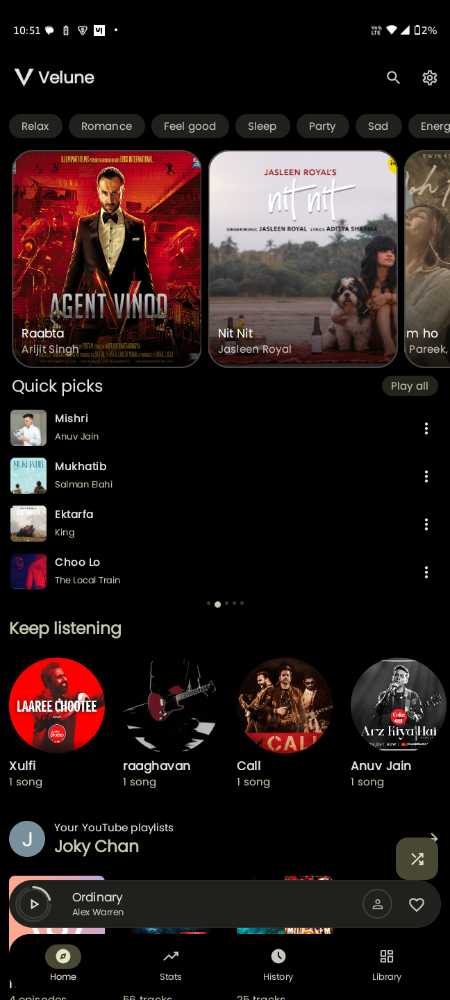
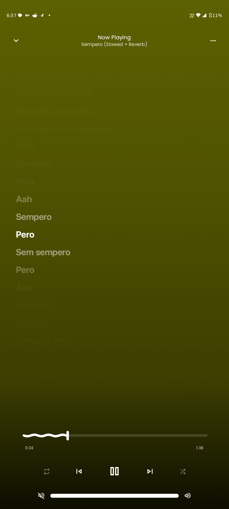
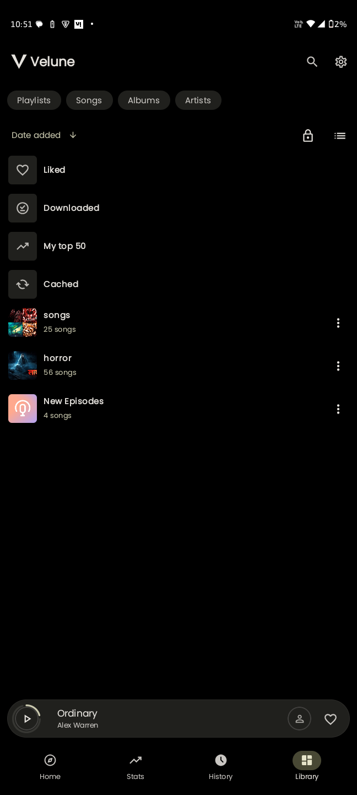
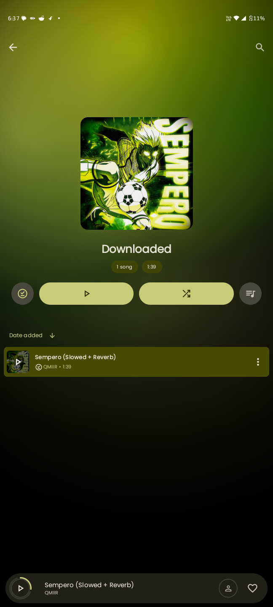
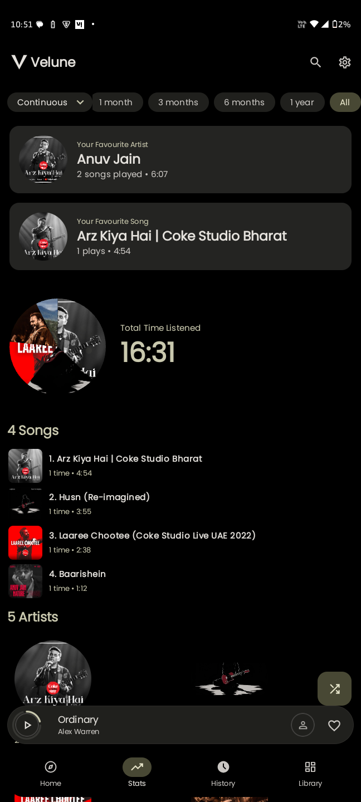
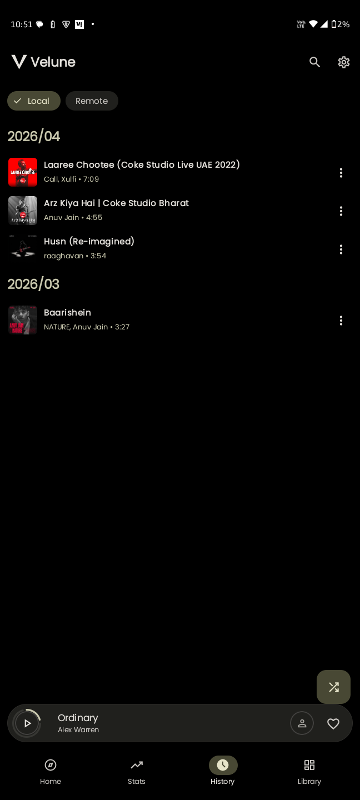
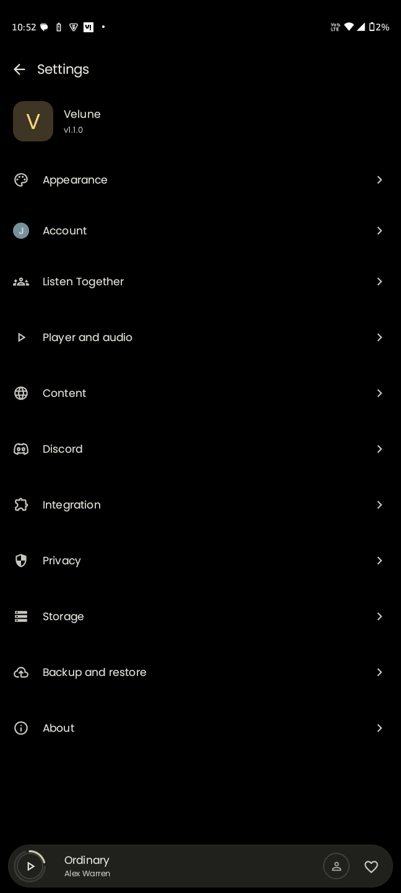

<div align="center">


# Velune

An Android client for YouTube Music, built with Kotlin and Jetpack Compose.

[](https://github.com/mohamedbassem612/Velune/actions/workflows/android.yml)
[](https://github.com/mohamedbassem612/Velune/releases/latest)
[](LICENSE)

</div>

## Screenshots

<div align="center">











</div>

## Install

Requires Android 8.0 (API 26) or newer.

1. Open the [latest release](https://github.com/mohamedbassem612/Velune/releases/latest) and download the APK.
2. Install it. Android will ask you to allow installs from your browser or file manager the first time.

You can also follow releases with [Obtainium](https://apps.obtainium.imranr.dev/redirect?r=obtainium://add/https://github.com/mohamedbassem612/Velune).

Updates: release builds check GitHub for a newer version when the app is opened (at most every 12 hours). If one is found, the app offers to download it and hands the APK to the Android installer. You still tap Install yourself, and the update must be signed with the same key as the installed app.

## Features

Playback
- Background playback with a media notification
- Crossfade between tracks
- Skip silence
- Audio normalization
- Tempo and pitch control
- Equalizer (built-in, and the system equalizer panel)
- Sleep timer

Library and discovery
- Sign in with a YouTube Music account to use your library
- Personalized home feed, charts, and mood and genre browsing
- Listening history, stats, and a year in music summary
- Listen Together sessions
- Backup and restore of app data

Lyrics
- Multiple lyrics sources: LrcLib, KuGou, SimpMusic, BetterLyrics, and YouTube Music
- Word-by-word highlighting when the source provides word timings
- Lyrics translation

Downloads
- Download songs for offline playback
- Export downloads as MP3 (FFmpeg)

Interface and integrations
- Material 3 with dynamic color
- Discord Rich Presence
- Last.fm scrobbling

## Offline and download updates

The offline work merged into `main` improves browsing, playback and the safety of downloaded music:

- Offline Home and local search focus on songs that can be played from an accessible MP3 or a complete audio cache. Offline Quick Picks start the selected song locally; online clicks continue to start a radio queue.
- Previously visited albums, artists, playlists, library and browse pages can use saved responses offline. Page snapshots are separated by account/session and locale, with a 64 MiB limit per partition. Pages that were never saved are unavailable offline.
- Likes and supported changes to existing remote playlists can be queued while offline and replayed in order when the app is running and a connection is available. Creating a new remote playlist still requires a connection.
- Downloads check the download cache and playback cache before resolving a network URL. Failed downloads can be retried after connectivity returns; completion clears the recorded retry count. Artwork and lyrics are prefetched when possible.
- MP3 conversion checks that the source cache is complete. Saved filenames include the song ID, older Android file writes use an atomic operation, and the original download is retained if saving or indexing the MP3 fails.
- Playback checks the cached byte range before treating a song as available offline, avoids fetching related songs when disconnected, and skips unavailable queued songs or pauses when none remain.
- Artwork metadata and Quick Picks snapshots use atomic file writes. The app no longer intentionally deletes the library database after a failed schema repair or uses Room's destructive migration fallback.
- Saved images use app files storage (`filesDir/coil`), so Android Settings > Clear cache no longer removes them. On upgrade, the app attempts to move the old `cacheDir/coil` folder when the new folder does not exist. Image cache size limits and trimming still apply.
- Failed visible thumbnails retry up to three times while online, with increasing delays (300 ms, 2 seconds, then 4 seconds), including after connectivity returns. A successful load resets the retry count.
- Settings > Storage > Clear image cache clears saved image caches and the in-memory image cache. Covers embedded in downloaded MP3s and covers saved for cached songs (`filesDir/covers`) are kept for offline use; other images load again from the internet. The confirmation dialog explains this behavior.
- GitHub Actions runs on pushes to `main` and `velune-offline-fixes`. The signed Universal Release APK is uploaded as an artifact; tagged releases can also be published through the workflow.

### Challenges and trade-offs

| Challenge | Approach and remaining limits |
|-----------|-------------------------------|
| A cached song could still trigger a network request | The download resolver now runs after the cache layers, and offline playback verifies local availability. A partial cache is not treated as a complete song. |
| Quick Picks used a network-backed radio queue offline | Offline clicks now create a local queue for the selected song. The radio queue remains available online. |
| Interrupted writes or failed library migrations could lose data | Atomic writes protect selected metadata files and older Android MP3 exports; destructive Room fallback and the final automatic database deletion were removed. The existing schema repair still requires migration testing, and a database that cannot be repaired may fail to open. |
| Offline playlist edits need to survive disconnection | Supported operations are persisted and replayed in order while the app is running. Delivery is at least once, so a crash after server success and before local acknowledgement can replay an operation; permanent server rejection stops replay. |
| Cached audio can have an unknown length or different formats | Cache metadata provides a fallback for the content length. Cache keys still use the song ID, so format changes can share a key and need further work. Temporary player caches can be evicted. Saved images survive Android's Clear cache action, but remain subject to image cache limits, trimming and the app's Clear image cache action. |
| Decompilation and test coverage have limits | The YouTube Music reference was decompiled Android client code with incomplete and obfuscated sections. The changes apply observed ideas through Media3 and Velune code; they do not reproduce Google's server backend. Android device tests are still needed for airplane mode, storage permissions, interrupted downloads and database migrations. |

For the detailed investigation and removed behavior, see [the offline and cache audit](docs/BACKEND_OFFLINE_AUDIT_AR.md) and [offline support notes](docs/OFFLINE_MODE.md).

## Tech stack

| Area | Libraries |
|------|-----------|
| Language | Kotlin |
| UI | Jetpack Compose, Material 3 |
| Playback | Media3 / ExoPlayer |
| Dependency injection | Hilt |
| Database | Room |
| Networking | Ktor |
| Async | Coroutines and Flow |
| Build | Gradle (Kotlin DSL), JDK 21 |

compileSdk and targetSdk are 36, minSdk is 26.

## Project structure

| Module | Purpose |
|--------|---------|
| `app` | The Android application |
| `innertube` | YouTube Music API client |
| `lrclib`, `kugou`, `simpmusic`, `betterlyrics` | Lyrics providers |
| `lastfm` | Last.fm API client |
| `kizzy` | Discord Rich Presence |
| `canvas` | Canvas artwork support |

## Build from source

Requirements: a recent Android Studio, JDK 21, and the Android SDK for API 36.

```bash
git clone https://github.com/mohamedbassem612/Velune.git
cd Velune
./gradlew :app:assembleUniversalDebug
```

The APK is written to `app/build/outputs/apk/universal/debug/`. You can also open the project in Android Studio, let Gradle sync, and run it.

A local release build (`assembleUniversalRelease`) is signed with the debug key unless `app/keystore/release.keystore` exists, so it will not update an installed official release.

## Releases

Releases are built by GitHub Actions and signed with the project key. Pushing a tag in the form `vMAJOR.MINOR.PATCH` (for example `v1.3.1`) builds the signed APK, sets the app version from the tag, and publishes a GitHub release with the APK attached. The required repository secrets are `ANDROID_KEYSTORE_BASE64`, `ANDROID_KEYSTORE_PASSWORD`, `ANDROID_KEY_ALIAS`, and `ANDROID_KEY_PASSWORD`.

Pushes to `Testing-features` build a signed Universal Release APK. Its filename is
`velune-testing-vMAJOR.MINOR.PATCH.apk` (for example, `velune-testing-v1.3.7.apk`).
Branch builds take the version from the newest semantic release tag; manual builds
can override it with `release_version`. The artifact is available on the Actions
run page for 14 days. Tag release assets use `velune-vMAJOR.MINOR.PATCH.apk`.

## Credits

Velune is based on the earlier Velune project by [nikhilvishwakarma00](https://github.com/nikhilvishwakarma00), and builds on the work of these projects:

- [ArchiveTune](https://github.com/koiverse/ArchiveTune)
- [Metrolist](https://github.com/mostafaalagamy/Metrolist)
- InnerTune
- Kizzy
- SimpMusic
- BetterLyrics

## Legal

Velune is an independent client. It is not affiliated with, endorsed by, or sponsored by YouTube or Google. Please support artists through official platforms.

Licensed under the [GNU General Public License v3.0](LICENSE).
